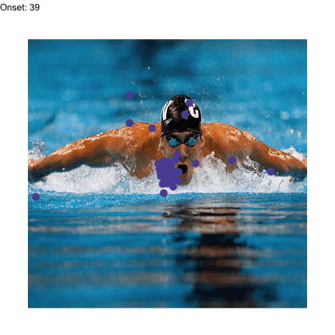

<!-- README.md is generated from README.Rmd. Please edit that file. -->

```{r setup, include = FALSE}
knitr::opts_chunk$set(
  collapse = TRUE,
  comment = "#>",
  message = FALSE,
  warning = FALSE,
  fig.path = "man/figures/README-",
  dpi = 144
)
```

```{r analysis, include = FALSE}
library(eyesim)
library(dplyr)

# The first 20 of the 103 participants keep this example to about a minute.
subjects <- head(sort(unique(wynn_study$Subject)), 20)
study <- wynn_study |> ungroup() |> filter(Subject %in% subjects)
test  <- wynn_test  |> ungroup() |> filter(Subject %in% subjects)

# One density map per participant and image: 800 x 600 pixel screen.
maps <- function(fixations, ...) {
  density_by(fixations, groups = c("Subject", "ImageNumberS"),
             sigma = 50, xbounds = c(0, 800), ybounds = c(0, 600),
             outdim = c(80, 60), ...)
}
study_maps <- maps(study)
test_maps  <- maps(test, keep_vars = "probe_type")

# Compare each test map with the same participant's study map of that image,
# and with 20 of their other study maps as a baseline.
set.seed(1)
sim <- template_similarity(study_maps, test_maps,
                           match_on = "ImageNumberS",
                           permute_on = "Subject",
                           method = "fisherz",
                           permutations = 20)
```

```{r numbers, include = FALSE}
by_subject <- sim |>
  group_by(Subject, probe_type) |>
  summarise(score = mean(eye_sim_diff, na.rm = TRUE), .groups = "drop") |>
  tidyr::pivot_wider(names_from = probe_type, values_from = score)

n_higher  <- sum(by_subject$old > by_subject$lure)
n_subj    <- nrow(by_subject)
mean_old  <- mean(by_subject$old)
mean_lure <- mean(by_subject$lure)
fmt <- function(x) formatC(x, format = "f", digits = 2)
```

# eyesim

<!-- badges: start -->
[](https://github.com/bbuchsbaum/eyesim/actions/workflows/R-CMD-check.yaml)
[](https://app.codecov.io/gh/bbuchsbaum/eyesim?branch=master)
<!-- badges: end -->

**Do people look at a picture the same way the second time they see it?**
eyesim is an R package that measures how similar two sets of eye fixations
are, and whether that similarity belongs to the picture or is just a habit of
the viewer.

```{r hero, echo = FALSE, fig.width = 8, fig.height = 3.3, fig.alt = "Eight small panels. Each shows one participant's study-phase fixation density for an image as grey shading, with their test-phase fixations on that image as dots. The top row shows studied images; the bottom row shows lures. Studied images have test fixations that fall on the dense regions more often."}
library(ggplot2)

set.seed(7)
one <- sim |> filter(Subject == subjects[1], !is.na(eye_sim_diff))
picked <- bind_rows(
  one |> filter(probe_type == "old")  |> slice_sample(n = 4),
  one |> filter(probe_type == "lure") |> slice_sample(n = 4)
) |>
  arrange(probe_type != "old", desc(eye_sim_diff)) |>
  mutate(panel = factor(sprintf("%s  %+.2f", ifelse(probe_type == "old", "studied", "lure"),
                                eye_sim_diff),
                        levels = unique(sprintf("%s  %+.2f",
                                                ifelse(probe_type == "old", "studied", "lure"),
                                                eye_sim_diff))))

templates <- study_maps |> filter(ImageNumberS %in% picked$ImageNumberS)
dens <- bind_rows(lapply(seq_len(nrow(picked)), function(i) {
  d <- templates$density[[match(picked$ImageNumberS[i], templates$ImageNumberS)]]
  data.frame(as.data.frame(d), panel = picked$panel[i])
}))
fix <- bind_rows(lapply(seq_len(nrow(picked)), function(i) {
  data.frame(as.data.frame(picked$fixgroup[[i]]), panel = picked$panel[i])
}))

ggplot() +
  geom_raster(data = dens, aes(x, y, fill = z), interpolate = TRUE) +
  geom_point(data = fix, aes(x, y), shape = 21, size = 1.6, stroke = 0.4,
             fill = "#d7301f", colour = "white") +
  scale_fill_gradient(low = "white", high = "grey35", guide = "none") +
  scale_y_reverse() +
  coord_equal(xlim = c(0, 800), ylim = c(600, 0), expand = FALSE) +
  facet_wrap(~panel, nrow = 2) +
  theme_void(base_size = 9) +
  theme(strip.text = element_text(hjust = 0, margin = margin(2, 0, 2, 0)),
        panel.border = element_rect(colour = "grey85", fill = NA, linewidth = 0.3),
        panel.spacing = unit(4, "pt"))
```

<sub>One participant, eight test trials drawn at random. Grey: where they
looked while studying the image. Red: where they looked at test. Top row:
the same image again. Bottom row: a lure, the other version of a studied
image. The number is the corrected similarity eyesim computes below.</sub>

## Installation

```r
# install.packages("remotes")
remotes::install_github("bbuchsbaum/eyesim")
```

## Example: does gaze at test revisit gaze at study?

The package ships with fixations from a recognition-memory experiment
(`wynn_study`, `wynn_test`): 103 participants studied 120 photographs, then
saw each again or saw a lure. Three steps answer the question.

```{r, ref.label = "analysis", eval = FALSE}
```

`template_similarity()` returns one row per test trial. `eye_sim` is the
similarity to the matching study map. `perm_sim` is the mean similarity to the
participant's *other* study maps: what anyone's habitual gaze would score.
`eye_sim_diff` is the difference, the part specific to the image.

```{r show-sim}
sim |> select(Subject, ImageNumberS, probe_type, eye_sim, perm_sim, eye_sim_diff)
```

Averaged within participants, studied images score higher than lures for
`r n_higher` of `r n_subj` people (mean `r fmt(mean_old)` versus
`r fmt(mean_lure)`, Fisher *z*):

```{r slope, echo = FALSE, fig.width = 3.6, fig.height = 3.4, fig.alt = "Slopegraph. Each grey line connects one participant's mean corrected similarity for lure trials (left) to studied trials (right). Most lines rise. A thick black line shows the group mean rising from about 0.06 to about 0.12."}
long <- by_subject |>
  tidyr::pivot_longer(c(lure, old), names_to = "probe", values_to = "score") |>
  mutate(probe = factor(probe, c("lure", "old"), c("lure", "studied")))
means <- long |> group_by(probe) |> summarise(score = mean(score))

ggplot(long, aes(probe, score, group = Subject)) +
  geom_hline(yintercept = 0, colour = "grey85", linewidth = 0.3) +
  geom_line(colour = "grey70", linewidth = 0.35) +
  geom_line(data = means, aes(group = 1), linewidth = 1.1) +
  geom_point(data = means, aes(group = 1), size = 2) +
  geom_text(data = means, aes(group = 1, label = fmt(score),
                              hjust = ifelse(probe == "lure", 1.4, -0.4)),
            size = 3) +
  scale_x_discrete(expand = expansion(add = 0.45)) +
  labs(x = NULL, y = "corrected similarity (Fisher z)") +
  theme_minimal(base_size = 9) +
  theme(panel.grid = element_blank(),
        axis.ticks.y = element_line(colour = "grey60", linewidth = 0.3),
        axis.text.x = element_text(size = 9, colour = "black"))
```

<sub>One line per participant (first 20 of 103). Thick line: mean.</sub>

Lures still score above zero: the two versions of each photograph share much
of their layout. The *difference* between the conditions is the memory signal.

## What eyesim does

| Question | Functions | Guide |
|:--|:--|:--|
| Where did people look? | `fixation_group()`, `eye_table()`, `eye_density()`, `density_by()` | [Getting started][start] |
| Is a viewing similar to its template, beyond chance? | `template_similarity()`, `similarity()` | [Getting started][start] |
| When during a viewing does it match? | `sample_density_time()` | [Getting started][start] |
| How often does gaze return to a place? | `fixation_revisits()`, `revisit_summary()` | [Getting started][start] |
| Do two scanpaths share shape, order and timing? | `scanpath()`, `multi_match()` | [MultiMatch][mm] |
| Is gaze consistent across repeats of a stimulus? | `repetitive_similarity()` | [Repetitive similarity][rep] |
| What if recall gaze is shrunk or shifted? | `contract_transform()`, `coral_transform()`, `template_similarity_cv()` | [Latent transforms][lat] |
| How much does a recall path identify its image? | `gaze_weave_cv()`, `gaze_transport_cv()` | [GazeWeave][gw] *(experimental)* |

Similarity can be measured as correlation (Pearson, Spearman, Fisher *z*),
cosine, L1, Jaccard, distance covariance, or earth mover's distance.

### GazeWeave (experimental)

GazeWeave asks a sharper question than a similarity score: given a recall
gaze path, how much does it raise the probability of picking out the image
being recalled? The answer is reported in bits, `gaze_info_bits`; zero means
gaze added nothing, and one bit means it doubled the correct image's
probability. All fitting is cross-validated, so a method that only fits noise
scores zero on average. Two engines are available: *Replay*, for
encoding-to-recall designs, and *Transport*, a symmetric alignment.

GazeWeave is under active development, and its interface may change. In
validation it has not yet outperformed simpler comparators at predicting
recognition responses, so treat its scores as exploratory. The
[vignette][gw] documents the evidence and failure modes.

## Learn more

The [documentation site](https://bbuchsbaum.github.io/eyesim/) has a
[function reference](https://bbuchsbaum.github.io/eyesim/reference/index.html)
and the guides linked above. `anim_scanpath()` animates a scanpath over its
stimulus:



Bug reports and questions: [GitHub issues](https://github.com/bbuchsbaum/eyesim/issues).
eyesim is released under the MIT license.

[start]: https://bbuchsbaum.github.io/eyesim/articles/eyesim.html
[mm]: https://bbuchsbaum.github.io/eyesim/articles/Multimatch.html
[rep]: https://bbuchsbaum.github.io/eyesim/articles/RepetitiveSimilarity.html
[lat]: https://bbuchsbaum.github.io/eyesim/articles/latent-transforms.html
[gw]: https://bbuchsbaum.github.io/eyesim/articles/GazeWeave.html
