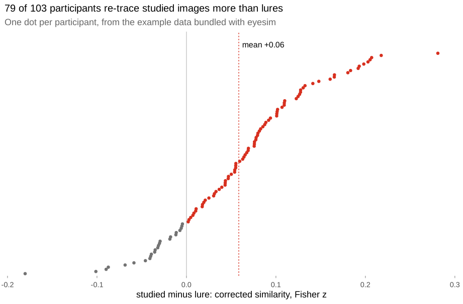
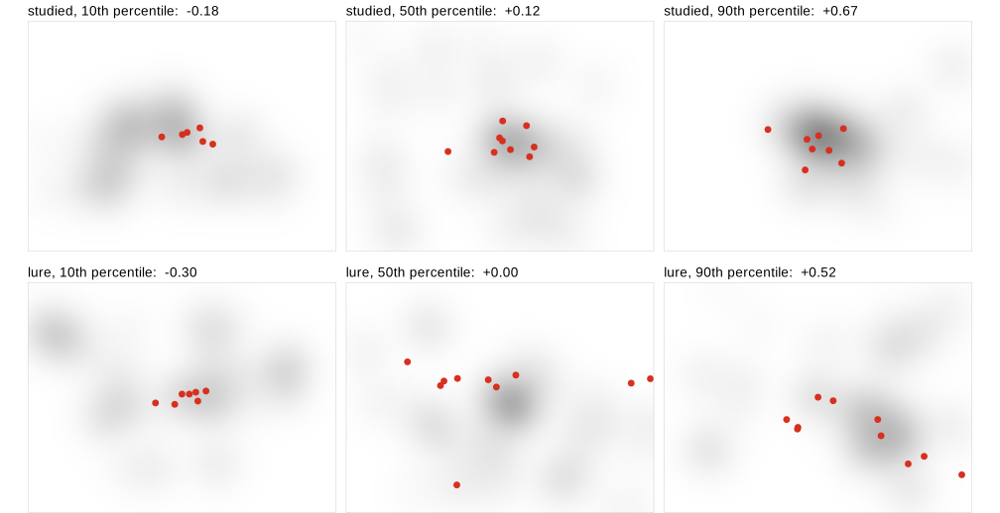

<!-- README.md is generated from README.Rmd. Please edit that file. -->

# eyesim

<!-- badges: start -->

[](https://github.com/bbuchsbaum/eyesim/actions/workflows/R-CMD-check.yaml)
[](https://app.codecov.io/gh/bbuchsbaum/eyesim?branch=master)
<!-- badges: end -->

**Do people look at a picture the same way the second time they see
it?** eyesim is an R package that measures how similar two sets of eye
fixations are, and how much of that similarity belongs to the picture
rather than to the viewer’s habits. It is written for researchers
studying memory, attention and scene viewing, and works with fixations
from any eye tracker.



## Installation

eyesim is under development and not yet on CRAN. Install it from GitHub:

``` r
# install.packages("remotes")
remotes::install_github("bbuchsbaum/eyesim")
```

## Example: does gaze at test re-trace gaze at study?

eyesim includes fixations from a recognition-memory experiment. In it,
103 participants studied 120 photographs, four times each
(`wynn_study`). At test they saw each photograph once more
(`wynn_test`): either the studied version (`probe_type == "old"`) or a
different version of the same scene (`"lure"`).

We call a participant’s study-phase density map for an image its
**template**. The question is whether test gaze falls where template
gaze fell, more than it would for an arbitrary image. Three steps answer
it:

``` r
library(eyesim)
library(dplyr)

# The datasets are grouped tibbles; ungroup before working across rows.
study <- ungroup(wynn_study)
test  <- ungroup(wynn_test)

# One density map per participant and image, on the 800 x 600 pixel image.
maps <- function(fixations, ...) {
  density_by(fixations, groups = c("Subject", "ImageNumberS"),
             sigma = 50, xbounds = c(0, 800), ybounds = c(0, 600),
             outdim = c(80, 60), ...)
}
templates  <- maps(study)
test_maps  <- maps(test, keep_vars = "probe_type")

# Score each test map against its template, and against 20 of the same
# participant's other templates as a baseline.
set.seed(1)
sim <- template_similarity(templates, test_maps,
                           match_on = "ImageNumberS",
                           permute_on = "Subject",
                           method = "fisherz",
                           permutations = 20)
```

This takes several minutes for all 12,240 test trials. To try it
quickly, first keep a few participants,
e.g. `filter(Subject %in% 5:14)`.

`template_similarity()` returns one row per test trial:

- `eye_sim` is the similarity between the test map and its template.
- `perm_sim` is the mean similarity to the participant’s templates for
  *other* images: their habitual way of viewing, such as a bias toward
  the centre of the screen.
- `eye_sim_diff`, the **corrected similarity**, is the difference, the
  part specific to this image.

``` r
sim %>%
  select(Subject, ImageNumberS, probe_type, eye_sim, perm_sim, eye_sim_diff) %>%
  head(5)
#> # A tibble: 5 x 6
#>   Subject ImageNumberS probe_type eye_sim perm_sim eye_sim_diff
#>     <dbl> <chr>        <chr>        <dbl>    <dbl>        <dbl>
#> 1       5 5_1          old          0.794    0.544        0.250
#> 2       5 5_10         old          1.25     0.417        0.836
#> 3       5 5_100        lure         0.542    0.835       -0.293
#> 4       5 5_101        lure         0.900    0.587        0.312
#> 5       5 5_102        lure         1.67     0.804        0.865
```

Single trials are noisy. The panels below show one participant’s trials
at the 10th, 50th and 90th percentile of corrected similarity. The grey
shading is the template and the red dots are the test fixations.



Averaged within each participant, the pattern is clear. Studied images
score higher than lures for 79 of 103 participants (mean 0.11 versus
0.05, Fisher *z*), as the figure at the top shows. Lures still score
above zero because the two versions of a scene share much of their
layout. The *difference* between conditions is consistent with gaze
reinstating what was studied.

## What eyesim does

| Question                                                         | Functions                                                               | Guide                                                                                           |
|:-----------------------------------------------------------------|:------------------------------------------------------------------------|:------------------------------------------------------------------------------------------------|
| Where did people look?                                           | `fixation_group()`, `eye_table()`, `density_by()`                       | [Getting started](https://bbuchsbaum.github.io/eyesim/articles/eyesim.html)                     |
| Is a viewing similar to its template, beyond chance?             | `template_similarity()`, `similarity()`                                 | [Getting started](https://bbuchsbaum.github.io/eyesim/articles/eyesim.html)                     |
| When during a viewing does it match?                             | `sample_density_time()`                                                 | [Getting started](https://bbuchsbaum.github.io/eyesim/articles/eyesim.html)                     |
| How often does gaze return to a place?                           | `fixation_revisits()`, `revisit_summary()`                              | [Getting started](https://bbuchsbaum.github.io/eyesim/articles/eyesim.html)                     |
| Do two scanpaths share shape, order and timing?                  | `scanpath()`, `multi_match()` (Dewhurst et al., 2012)                   | [MultiMatch](https://bbuchsbaum.github.io/eyesim/articles/Multimatch.html)                      |
| Is gaze consistent across repeats of a stimulus?                 | `repetitive_similarity()`                                               | [Repetitive similarity](https://bbuchsbaum.github.io/eyesim/articles/RepetitiveSimilarity.html) |
| What if recall gaze is shrunk or shifted?                        | `contract_transform()`, `coral_transform()`, `template_similarity_cv()` | [Latent transforms](https://bbuchsbaum.github.io/eyesim/articles/latent-transforms.html)        |
| How much does a recall path identify its image? *(experimental)* | `gaze_weave_cv()`, `gaze_transport_cv()`                                | [GazeWeave](https://bbuchsbaum.github.io/eyesim/articles/GazeWeave.html)                        |

`similarity()` and `template_similarity()` take a `method`: Pearson,
Spearman or Fisher *z* correlation, cosine, L1, Jaccard, distance
covariance, or earth mover’s distance.

**GazeWeave** is experimental. It scores, in bits, how much a recall
gaze path helps identify which image is being recalled. In validation it
has not yet outperformed simpler measures, so read the
[vignette](https://bbuchsbaum.github.io/eyesim/articles/GazeWeave.html)
before relying on it.

## Learn more

The [documentation site](https://bbuchsbaum.github.io/eyesim/) has the
guides above and a full [function
reference](https://bbuchsbaum.github.io/eyesim/reference/index.html).
Report bugs and ask questions on [GitHub
issues](https://github.com/bbuchsbaum/eyesim/issues).

## Citation

To cite eyesim, run `citation("eyesim")`. The example data come from the
pattern-completion experiment of Wynn, Ryan and Buchsbaum (2020), *Eye
movements support behavioral pattern completion*, PNAS 117(11),
6246–6254,
[doi:10.1073/pnas.1917586117](https://doi.org/10.1073/pnas.1917586117).

eyesim is released under the MIT license.
