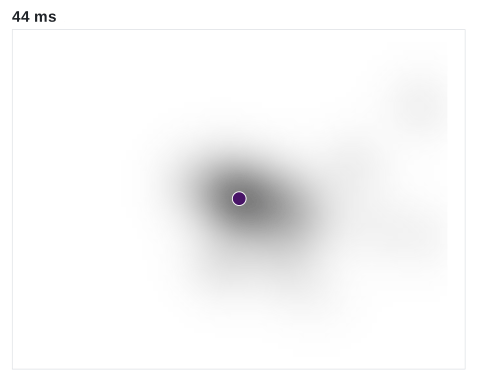

<!-- README.md is generated from README.Rmd. Please edit that file. -->

# eyesim

<!-- badges: start -->

[](https://github.com/bbuchsbaum/eyesim/actions/workflows/R-CMD-check.yaml)
[](https://app.codecov.io/gh/bbuchsbaum/eyesim?branch=master)
<!-- badges: end -->

**Do people look at a picture the same way the second time they see
it?** eyesim is an R package that measures how similar two sets of eye
fixations are, and how much of that similarity belongs to the picture
rather than to the viewer’s habits. It is written for researchers
studying memory, attention and scene viewing, and works with fixations
from any eye tracker. The example below uses synthetic data with a
deliberately planted study-test similarity difference.


## Installation

eyesim is under development and not yet on CRAN. Install it from GitHub:

``` r
# install.packages("remotes")
remotes::install_github("bbuchsbaum/eyesim")
```

## Example: does gaze at test re-trace gaze at study?

We simulate 12 participants viewing 12 images at study and test. For
half the images (`probe_type == "old"`), test fixations return near the
study locations. For the other half (`"lure"`), test locations are
shifted. These are generated patterns, not observations from a
recognition-memory experiment. The former Wynn datasets are not
distributed pending redistribution clearance.

We call a participant’s study-phase density map for an image its
**template**. The question is whether test gaze falls where template
gaze fell, more than it would for an arbitrary image. Three steps answer
it:

``` r
library(eyesim)
library(dplyr)

# A reproducible synthetic experiment; no participant data are required.
set.seed(53)
study <- expand.grid(Subject = 1:12, ImageNumberS = 1:12)
centers <- cbind(runif(nrow(study), 150, 650),
                 runif(nrow(study), 120, 480))
make_fixations <- function(center, spread) {
  fixation_group(x = rnorm(18, center[1], spread),
                 y = rnorm(18, center[2], spread),
                 onset = seq(0, 3400, 200), duration = rep(180, 18))
}
study$fixgroup <- lapply(seq_len(nrow(study)), function(i) {
  make_fixations(centers[i, ], 30)
})
test <- study[c("Subject", "ImageNumberS")]
test$probe_type <- ifelse(test$ImageNumberS %% 2 == 0, "old", "lure")
test$fixgroup <- lapply(seq_len(nrow(test)), function(i) {
  shift <- if (test$probe_type[i] == "old") c(0, 0) else c(100, -70)
  make_fixations(centers[i, ] + shift, 45)
})

# One density map per participant and image, on the 800 x 600 pixel image.
maps <- function(fixations, ...) {
  density_by(fixations, groups = c("Subject", "ImageNumberS"),
             sigma = 50, xbounds = c(0, 800), ybounds = c(0, 600),
             outdim = c(40, 30), ...) %>%
    mutate(match_key = paste(Subject, ImageNumberS, sep = "_"))
}
templates  <- maps(study)
test_maps  <- maps(test, keep_vars = "probe_type")

# Score each test map against its template, and against up to 20 of the same
# participant's other templates as a baseline.
set.seed(1)
sim <- template_similarity(templates, test_maps,
                           match_on = "match_key",
                           permute_on = "Subject",
                           method = "fisherz",
                           permutations = 20)
```

This small example scores 144 test trials. The compound `match_key`
ensures that each test map matches the same participant and image;
matching only on image would select the first participant’s template.

`template_similarity()` returns one row per test trial:

- `eye_sim` is the similarity between the test map and its template.
- `perm_sim` is the mean similarity to the participant’s templates for
  *other* images, a baseline that retains recurring viewing patterns.
- `eye_sim_diff`, the **corrected similarity**, subtracts that baseline.
  It is a descriptive contrast, not an automatic decomposition of
  memory, image content and viewing habits.

``` r
sim %>%
  select(Subject, ImageNumberS, probe_type, eye_sim, perm_sim, eye_sim_diff) %>%
  head(5) %>%
  as.data.frame()
#>   Subject ImageNumberS probe_type   eye_sim     perm_sim eye_sim_diff
#> 1       1            1       lure 0.3715877  0.012313629    0.3592741
#> 2       1            2        old 2.5100014  0.031805436    2.4781959
#> 3       1            3       lure 0.3175950 -0.071179139    0.3887742
#> 4       1            4        old 1.7638458  0.241910844    1.5219349
#> 5       1            5       lure 0.3479633  0.004641308    0.3433219
```

Single trials are noisy. The panels below show one participant’s trials
at the 10th, 50th and 90th percentile of corrected similarity. The grey
shading is the template and the red dots are the test fixations.


Averaged within each simulated participant, the old condition scores
higher than the lure condition for 12 of 12 participants (mean 1.81
versus 0.26, Fisher *z*). This recovers the spatial similarity
difference built into the simulation; it is not evidence about human
memory. An empirical interpretation would require an appropriate study
design and controls for shared image content and viewing habits.

## What eyesim does

| Question | Functions | Guide |
|:---|:---|:---|
| Where did people look? | `fixation_group()`, `eye_table()`, `density_by()` | [Getting started](https://bbuchsbaum.github.io/eyesim/articles/eyesim.html) |
| Is a viewing similar to its template, beyond chance? | `template_similarity()`, `similarity()` | [Getting started](https://bbuchsbaum.github.io/eyesim/articles/eyesim.html) |
| Do individual fixations favor study locations over controls? | `reference_maps()`, `sample_controls()`, `mismatch_draws()` | [Fixation scoring](https://bbuchsbaum.github.io/eyesim/articles/fixation-reference-scoring.html) |
| When during a viewing does it match? | `sample_density_time()` | [Getting started](https://bbuchsbaum.github.io/eyesim/articles/eyesim.html) |
| How often does gaze return to a place? | `fixation_revisits()`, `revisit_summary()` | [Getting started](https://bbuchsbaum.github.io/eyesim/articles/eyesim.html) |
| Do two scanpaths share shape, order and timing? | `scanpath()`, `multi_match()` (Dewhurst et al., 2012) | [MultiMatch](https://bbuchsbaum.github.io/eyesim/articles/Multimatch.html) |
| Is gaze consistent across repeats of a stimulus? | `repetitive_similarity()` | [Repetitive similarity](https://bbuchsbaum.github.io/eyesim/articles/RepetitiveSimilarity.html) |
| What if recall gaze is shrunk or shifted? | `contract_transform()`, `coral_transform()`, `template_similarity_cv()` | [Latent transforms](https://bbuchsbaum.github.io/eyesim/articles/latent-transforms.html) |
| How much does a recall path identify its image? *(experimental)* | `gaze_weave_cv()`, `gaze_transport_cv()` | [GazeWeave](https://bbuchsbaum.github.io/eyesim/articles/GazeWeave.html) |

`similarity()` and `template_similarity()` take a `method`: Pearson,
Spearman or Fisher *z* correlation, cosine, L1, Jaccard, distance
covariance, or earth mover’s distance.

**GazeWeave** is experimental. It scores, in bits, how much a recall
gaze path helps identify which image is being recalled. In validation it
has not yet outperformed simpler measures, so read the
[vignette](https://bbuchsbaum.github.io/eyesim/articles/GazeWeave.html)
before relying on it.

## Learn more

The [documentation site](https://bbuchsbaum.github.io/eyesim/) has the
guides above and a full [function
reference](https://bbuchsbaum.github.io/eyesim/reference/index.html).
Report bugs and ask questions on [GitHub
issues](https://github.com/bbuchsbaum/eyesim/issues).

`anim_scanpath()` replays a viewing in real time. Here it replays the
90th-percentile studied trial from the panels above, over its template:



## Citation

To cite eyesim, run `citation("eyesim")`. The example on this page is
synthetic.

eyesim is released under the MIT license.
