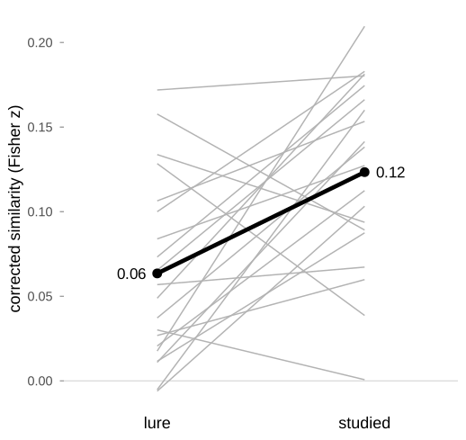
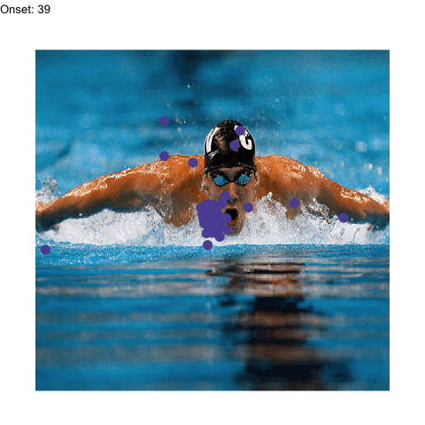

<!-- README.md is generated from README.Rmd. Please edit that file. -->

# eyesim

<!-- badges: start -->

[](https://github.com/bbuchsbaum/eyesim/actions/workflows/R-CMD-check.yaml)
[](https://app.codecov.io/gh/bbuchsbaum/eyesim?branch=master)
<!-- badges: end -->

**Do people look at a picture the same way the second time they see
it?** eyesim is an R package that measures how similar two sets of eye
fixations are, and whether that similarity belongs to the picture or is
just a habit of the viewer.


<sub>One participant, eight test trials drawn at random. Grey: where
they looked while studying the image. Red: where they looked at test.
Top row: the same image again. Bottom row: a lure, the other version of
a studied image. The number is the corrected similarity eyesim computes
below.</sub>

## Installation

``` r
# install.packages("remotes")
remotes::install_github("bbuchsbaum/eyesim")
```

## Example: does gaze at test revisit gaze at study?

The package ships with fixations from a recognition-memory experiment
(`wynn_study`, `wynn_test`): 103 participants studied 120 photographs,
then saw each again or saw a lure. Three steps answer the question.

``` r
library(eyesim)
library(dplyr)

# The first 20 of the 103 participants keep this example to about a minute.
subjects <- head(sort(unique(wynn_study$Subject)), 20)
study <- wynn_study |> ungroup() |> filter(Subject %in% subjects)
test  <- wynn_test  |> ungroup() |> filter(Subject %in% subjects)

# One density map per participant and image: 800 x 600 pixel screen.
maps <- function(fixations, ...) {
  density_by(fixations, groups = c("Subject", "ImageNumberS"),
             sigma = 50, xbounds = c(0, 800), ybounds = c(0, 600),
             outdim = c(80, 60), ...)
}
study_maps <- maps(study)
test_maps  <- maps(test, keep_vars = "probe_type")

# Compare each test map with the same participant's study map of that image,
# and with 20 of their other study maps as a baseline.
set.seed(1)
sim <- template_similarity(study_maps, test_maps,
                           match_on = "ImageNumberS",
                           permute_on = "Subject",
                           method = "fisherz",
                           permutations = 20)
```

`template_similarity()` returns one row per test trial. `eye_sim` is the
similarity to the matching study map. `perm_sim` is the mean similarity
to the participant’s *other* study maps: what anyone’s habitual gaze
would score. `eye_sim_diff` is the difference, the part specific to the
image.

``` r
sim |> select(Subject, ImageNumberS, probe_type, eye_sim, perm_sim, eye_sim_diff)
#> # A tibble: 2,398 x 6
#>    Subject ImageNumberS probe_type eye_sim perm_sim eye_sim_diff
#>      <dbl> <chr>        <chr>        <dbl>    <dbl>        <dbl>
#>  1       5 5_1          old          0.794    0.544       0.250 
#>  2       5 5_10         old          1.25     0.417       0.836 
#>  3       5 5_100        lure         0.542    0.835      -0.293 
#>  4       5 5_101        lure         0.900    0.587       0.312 
#>  5       5 5_102        lure         1.67     0.804       0.865 
#>  6       5 5_103        lure         1.22     0.778       0.437 
#>  7       5 5_104        lure         0.647    0.590       0.0565
#>  8       5 5_105        lure         1.48     0.704       0.776 
#>  9       5 5_106        lure         0.237    0.656      -0.419 
#> 10       5 5_107        lure         0.300    0.267       0.0331
#> # i 2,388 more rows
```

Averaged within participants, studied images score higher than lures for
16 of 20 people (mean 0.12 versus 0.06, Fisher *z*):



<sub>One line per participant (first 20 of 103). Thick line: mean.</sub>

Lures still score above zero: the two versions of each photograph share
much of their layout. The *difference* between the conditions is the
memory signal.

## What eyesim does

| Question                                             | Functions                                                               | Guide                                                                                           |
|:-----------------------------------------------------|:------------------------------------------------------------------------|:------------------------------------------------------------------------------------------------|
| Where did people look?                               | `fixation_group()`, `eye_table()`, `eye_density()`, `density_by()`      | [Getting started](https://bbuchsbaum.github.io/eyesim/articles/eyesim.html)                     |
| Is a viewing similar to its template, beyond chance? | `template_similarity()`, `similarity()`                                 | [Getting started](https://bbuchsbaum.github.io/eyesim/articles/eyesim.html)                     |
| When during a viewing does it match?                 | `sample_density_time()`                                                 | [Getting started](https://bbuchsbaum.github.io/eyesim/articles/eyesim.html)                     |
| How often does gaze return to a place?               | `fixation_revisits()`, `revisit_summary()`                              | [Getting started](https://bbuchsbaum.github.io/eyesim/articles/eyesim.html)                     |
| Do two scanpaths share shape, order and timing?      | `scanpath()`, `multi_match()`                                           | [MultiMatch](https://bbuchsbaum.github.io/eyesim/articles/Multimatch.html)                      |
| Is gaze consistent across repeats of a stimulus?     | `repetitive_similarity()`                                               | [Repetitive similarity](https://bbuchsbaum.github.io/eyesim/articles/RepetitiveSimilarity.html) |
| What if recall gaze is shrunk or shifted?            | `contract_transform()`, `coral_transform()`, `template_similarity_cv()` | [Latent transforms](https://bbuchsbaum.github.io/eyesim/articles/latent-transforms.html)        |
| How much does a recall path identify its image?      | `gaze_weave_cv()`, `gaze_transport_cv()`                                | [GazeWeave](https://bbuchsbaum.github.io/eyesim/articles/GazeWeave.html) *(experimental)*       |

Similarity can be measured as correlation (Pearson, Spearman, Fisher
*z*), cosine, L1, Jaccard, distance covariance, or earth mover’s
distance.

### GazeWeave (experimental)

GazeWeave asks a sharper question than a similarity score: given a
recall gaze path, how much does it raise the probability of picking out
the image being recalled? The answer is reported in bits,
`gaze_info_bits`; zero means gaze added nothing, and one bit means it
doubled the correct image’s probability. All fitting is cross-validated,
so a method that only fits noise scores zero on average. Two engines are
available: *Replay*, for encoding-to-recall designs, and *Transport*, a
symmetric alignment.

GazeWeave is under active development, and its interface may change. In
validation it has not yet outperformed simpler comparators at predicting
recognition responses, so treat its scores as exploratory. The
[vignette](https://bbuchsbaum.github.io/eyesim/articles/GazeWeave.html)
documents the evidence and failure modes.

## Learn more

The [documentation site](https://bbuchsbaum.github.io/eyesim/) has a
[function
reference](https://bbuchsbaum.github.io/eyesim/reference/index.html) and
the guides linked above. `anim_scanpath()` animates a scanpath over its
stimulus:



Bug reports and questions: [GitHub
issues](https://github.com/bbuchsbaum/eyesim/issues). eyesim is released
under the MIT license.
