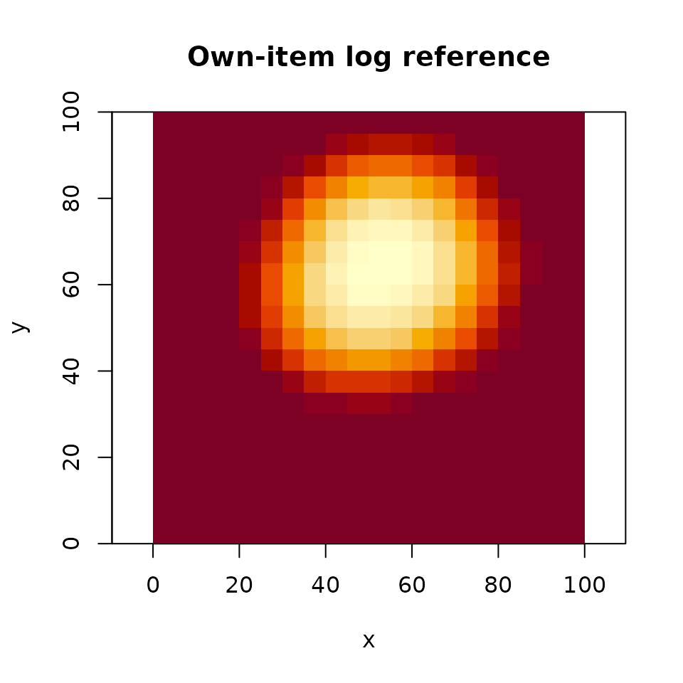
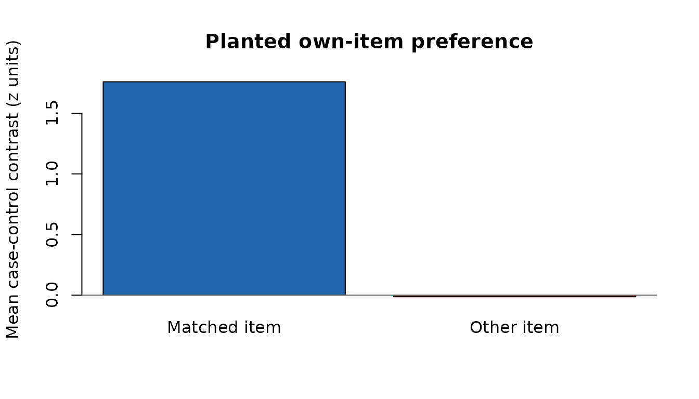

# Fixation-level scoring with leave-out references

Does a test fixation land where the person’s study gaze predicts, beyond
where that person usually looks? This workflow constructs study
references, draws control locations, and scores both. It keeps the
control and template assignments so the analysis can be replayed or
compared with a different scoring choice. The example uses synthetic
data with a planted preference for each person’s study locations.

## Prepare study maps and test fixations

We simulate eight people viewing six items. Every person/item pair has
its own preferred location. Test fixations return near that location.
Coordinates run from 0 to 100; onsets and durations are in milliseconds.

``` r

set.seed(53)
study <- expand.grid(subject = paste0("s", 1:8), item = paste0("i", 1:6),
                     stringsAsFactors = FALSE)
centers <- cbind(runif(nrow(study), 20, 80), runif(nrow(study), 20, 80))
study$fixgroup <- lapply(seq_len(nrow(study)), function(i) {
  fixation_group(
    x = rnorm(12, centers[i, 1], 5), y = rnorm(12, centers[i, 2], 5),
    onset = seq(0, 1100, 100), duration = rep(100, 12)
  )
})
test <- do.call(rbind, lapply(seq_len(nrow(study)), function(i) {
  data.frame(subject = study$subject[i], item = study$item[i],
             trial = study$item[i], epoch = "test",
             x = rnorm(6, centers[i, 1], 7),
             y = rnorm(6, centers[i, 2], 7), onset = seq(0, 500, 100))
}))

maps <- density_by(
  study, groups = c("subject", "item"), sigma = 8,
  xbounds = c(2.5, 97.5), ybounds = c(2.5, 97.5), outdim = c(20, 20),
  window = c(50, 950), window_weight = "overlap", duration_weighted = TRUE
)
```

These bounds put the grid at the centers of 5-unit cells. Lookup uses
the nearest grid point, with half-to-even rounding at ties and clamping
at the edges. It does not interpolate between cells. The overlap window
clips the first and last retained fixations to 50 milliseconds. The
default onset window would instead select fixations by their onset and
retain their full durations.

## Construct references, assign controls, and score

``` r

refs <- reference_maps(maps, floor = 1 / (10 * 20 * 20))
strata <- sample_controls(test, n = 10, draws = 3, stratify_by = "epoch", seed = 7)
scored <- score_strata(strata, refs)
contrasts <- case_control_contrast(scored, by = "trial")

aggregate(contrasts[refs$refs], list(control_draw = contrasts$draw), mean)
#>   control_draw self_item self_other_items others_item others_other_items
#> 1            1  1.576836       -0.8474580 -0.07462405         0.01288271
#> 2            2  1.585966       -0.8443119 -0.07317076         0.02254866
#> 3            3  1.588978       -0.8338852 -0.10141726        -0.01824821
```

Each contrast is the case score minus the mean of its control scores.
Trial contrasts average fixation contrasts equally. Positive values mean
that cases score higher than controls under that reference. Control
draws remain separate; averaging across draws is an explicit analysis
choice.

The four reference columns answer different questions:

| Reference            | Contributors                              |
|----------------------|-------------------------------------------|
| `self_item`          | This person’s study map for this item     |
| `self_other_items`   | This person’s study maps for other items  |
| `others_item`        | Other people’s study maps for this item   |
| `others_other_items` | Other people’s study maps for other items |

For the last reference, the package first averages other items within
each person, then averages those person means equally. Thus a person
with more available items does not receive greater weight. NULL maps are
missing, not zero-valued maps. `refs$counts` records contributing maps
for self references and contributing people for other references.
`min_n` makes undersupported references return missing scores while
preserving their keys.

By default, each source map is normalized to unit sum, transformed with
`log(value + floor)`, and then averaged. The floor is an explicit
additive offset. `space = "density"` averages densities instead. These
operations produce different references; scoring never logs a prepared
reference again. Use `space = "density", transform = "log"` to take the
log after averaging density values. The constructor records both the
aggregation and output domains.

``` r

refs$keys[1, ]
#>   subject item
#> 1      s1   i1
refs$counts[1, ]
#>   self_item self_other_items others_item others_other_items
#> 1         1                5           7                  7
own <- reference_map(refs, row = 1, ref = "self_item")
image(own$x, own$y, own$z, xlab = "x", ylab = "y", asp = 1,
      main = "Own-item log reference", col = hcl.colors(30, "YlOrRd"))
```



## Inspect and reuse assignments

``` r

head(strata[c("subject", "item", "case_id", "control_id", "draw",
              "stratum", "is_case", "x", "y")], 4)
#>         subject item case_id control_id draw stratum is_case        x        y
#> 1...1        s1   i1       1          1    1       1    TRUE 54.51360 66.24832
#> 1.1...2      s1   i1       1        100    1       1   FALSE 74.94712 36.29390
#> 1.2...3      s1   i1       1        193    1       1   FALSE 24.69938 33.92677
#> 1.3...4      s1   i1       1        244    1       1   FALSE 31.29766 19.54338
```

For observed controls, `control_id` identifies the donor row of `test`.
Other metadata belongs to the case, including its item and trial. Donors
come from the same subject and epoch, excluding the case’s entire trial
and every trial of the case’s item. Item exclusion matters for repeated
presentations: own-item donors can land on the matched template’s
hotspots and attenuate its contrast. The `item` column is detected by
default; pass `item = "stimulus"` for a custom column or `item = NULL`
for trial-only exclusion. Without an item column, the default also uses
trial-only exclusion. With `replace = "auto"`, sampling uses replacement
only when the pool is too small. Empty pools produce an error. Seeded
constructors restore the caller’s RNG state; scoring uses no random
numbers. Save the assignment table along with the reference set to
replay an analysis.

Uniform controls require explicit bounds. Map controls draw grid
locations independently with replacement according to a supplied
density; requesting `replace = FALSE` is an error for map controls.
These methods define different comparison distributions. There is
deliberately no control-only jitter: moving controls away from the
center while leaving centered cases unchanged can manufacture a positive
preference even when cases and unperturbed controls coincide.

## Separate map preparation from score scaling

[`score_strata()`](https://bbuchsbaum.github.io/eyesim/reference/score_strata.md)
standardizes each reference column within subject and control draw,
using all case and control rows. This differs from z-scoring the cells
of a density map. The separate fit/apply interface makes reuse explicit:

``` r

raw <- score_strata(strata, refs, standardize = "none")
scaling <- fit_score_scaling(raw, by = c("subject", "draw"))
replayed <- apply_score_scaling(raw, scaling)
stopifnot(identical(replayed, scored))
```

Fitting each control draw separately prevents adding draws from altering
earlier draws’ scaling. Constant score columns map to zero. Missing
scores stay missing and propagate into contrasts; they are not silently
removed from a control pool. Applying a fit to an unseen group produces
an error.

## Compare matched and mismatched templates on shared controls

``` r

assignments <- mismatch_assignments(strata, refs, n = 20, seed = 31)
null <- mismatch_draws(strata, refs, assignments = assignments,
                        replace_ref = "self_item", by = "trial")

comparison <- data.frame(
  assignment = c("Matched item", "Other item"),
  mean_contrast = c(mean(null$paired_observed$self_item), mean(null$contrasts$self_item))
)
comparison
#>     assignment mean_contrast
#> 1 Matched item    1.75923390
#> 2   Other item   -0.01346363
```

Each replacement is another valid study item from the same subject. One
replacement applies to the entire trial, including all its fixations,
controls, and control draws. `replace_ref = "self_item"` changes only
the own-item reference; `replace_ref = "all"` replaces the full
reference tuple coherently. The original case metadata remains attached
to the returned contrasts.

By default, each draw excludes controls whose donor item is either the
case’s item or the replacement item, including donors from repeated
trials of either item. This also corrects older saved assignments drawn
with trial-only exclusion. Own-item donors would attenuate the matched
contrast; replacement-item donors would push the mismatched contrast
below zero under a real matched effect. `control_id` and the saved
`control_sources` attribute identify donors even after selecting a
subset of cases. No controls are redrawn; a stratum left without
controls produces an error. Increasing the initial control count can
help only if eligible donors exist. A subject with only two test items
cannot support a comparison between those items using observed controls,
even with repeated trials. In particular, two test trials containing
those items always leave an empty pool. Use
[`saveRDS()`](https://rdrr.io/r/base/readRDS.html) to preserve donor
metadata when saving a subset of cases.

`paired_observed` rescores the matched template using exactly the same
retained controls and scaling as each mismatched contrast. The plot
compares these paired results. `observed` retains the original contrast
on all controls for context; if those controls came from trial-only
sampling, repeated own-item donors can still attenuate `observed`.
`control_policy = "fixed"` retains all supplied controls, including
replacement-item donors. Combine it with
`sample_controls(..., item = NULL)` to reproduce the original
item-discrimination baseline. Its negative value under a real effect
should not be interpreted as an absence-of-reinstatement baseline.



Scaling is refitted on the retained mismatched scores in each draw by
default, and that same fit is applied to both members of the pair. Set
`restandardize = FALSE` to apply the original observed fit to both
instead. Use `standardize = "none"` for comparisons in raw reference
units. Neither option alone establishes an exact randomization test.
Item replacement must be justified by the study design and the null
hypothesis; repeated items and condition differences can violate
exchangeability. The function therefore returns draws and assignments
without automatic p-values.

The reference scores are available as predictors for an analysis chosen
by the researcher. An own-item contrast can contain generic
image-content effects: compare it with the other references before
interpreting it as person-specific reinstatement. Conditioning on
correlated reference scores requires a model and an interpretation; it
is not an automatic decomposition supplied by this API.

## Existing entry points

[`sample_density()`](https://bbuchsbaum.github.io/eyesim/reference/sample_density.md)
still samples one density map with its previous defaults. It also
accepts a named map list or map table, with long or wide results.
[`template_sample()`](https://bbuchsbaum.github.io/eyesim/reference/template_sample.md)
forwards sampling options, and
[`sample_density_time()`](https://bbuchsbaum.github.io/eyesim/reference/sample_density_time.md)
retains its time-series and averaged-baseline output. These interfaces
share map preparation and lookup with the new workflow. Use explicit
strata and mismatch assignments when the identities of controls and
replacement draws must remain available.
